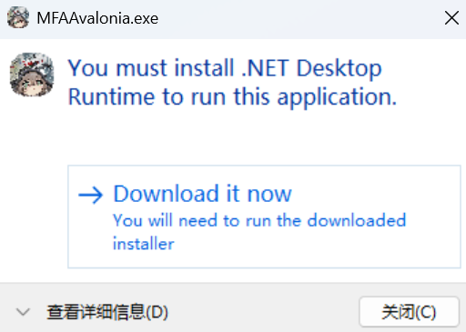
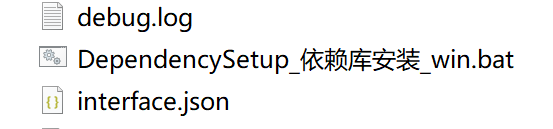
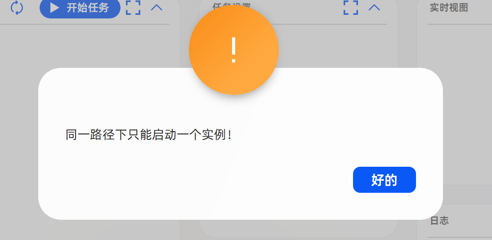
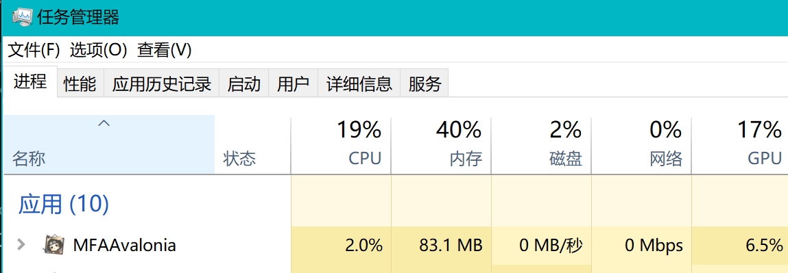
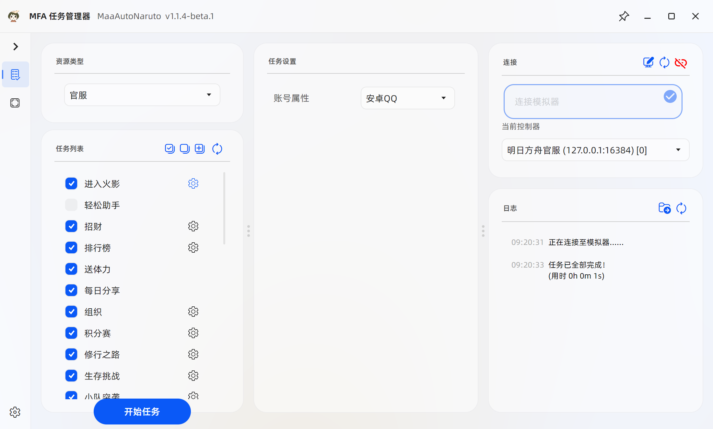
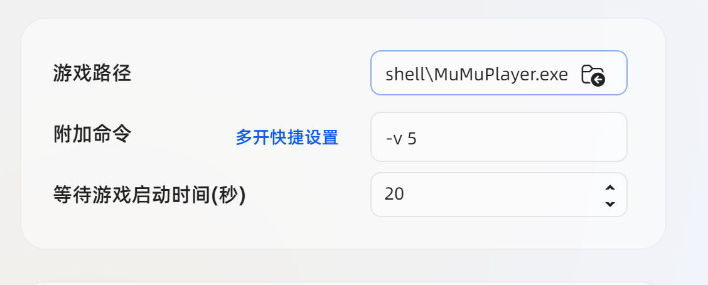

# 常见问题

官方教学视频：

[电脑端使用](https://www.bilibili.com/video/BV1bz9kBNEbm)

[电脑端adb链接](https://www.bilibili.com/video/BV1KHNn67Eno)

[安卓端使用](https://www.bilibili.com/video/BV1sBnA6iEcu)

[安卓端shizuku](https://www.bilibili.com/video/BV1PF4y6KEvs)

## 项目相关

1. Q: 硬件配置有要求吗？
    <!-- 参考文献 -->
    <!-- https://mumu.163.com/help/20251216/35048_1276766.html -->
    <!-- 没找到火影的，找了个差不多类型的 -->
    A: 电脑版最低配置:CPU i5 9400 及以上，显卡 GTX 1650 Super 4G 独显及以上，内存8G及以上。手机版推荐：骁龙870及以上，8G内存及以上。

2. Q: 可以在手机上用吗？

    A: 可以使用安卓版man

3. Q: 感觉没有xxx的xxx好用 / 为什么不做xxx功能？

    A: 开发组现在缺人，这些功能你来写吧。

4. Q: 打不开Github？

    A: 请使用科学上网忍具,没有可在 bilibili 搜索 github 链接教程

5. Q: 下载速度特别慢或无法更新？

    A: 若从 `GitHub` 源下载速度较慢，可搜索相关加速教程，或加入 QQ 群咨询其他用户。

    MAN 现已支持 [Mirror酱](https://mirrorchyan.com/zh/projects?rid=MaaAutoNaruto&os=windows&arch=x64&channel=stable&source=MaaAutoNarutogh-doc)高速下载服务，可大幅提升下载速度，同时提供人工客服答疑。

    如果只需要下载软件，也可以优先使用网页下载，相对更容易下载成功。

6. Q: GitHub 源更新报错怎么办？

    A: 如果报错 `403 rate limit exceeded`，说明 GitHub 匿名请求已达到限制。可以点击“关于 token”，前往 GitHub 生成个人 token，并填入“更新 token”栏。token 以 `github_pat` 开头。

    新版本下载失败可能是 GitHub 链接不稳定导致，请尝试更稳定的 GitHub 链接方式，或使用 [Mirror酱](https://mirrorchyan.com/zh/projects?rid=MaaAutoNaruto&os=windows&arch=x64&channel=stable&source=MaaAutoNarutogh-doc)下载。

## 软件启动问题

### PC 版

1. Q: 双击exe后无反应或出现以下弹窗怎么办？

    

    A: 运行目录内的依赖安装脚本并重启电脑即可。

    

    Q: 脚本运行失败或者无法运行怎么办？

    A: [QQ群](http://qm.qq.com/cgi-bin/qm/qr?_wv=1027&k=w32iIG_oNqlyIvZOH3qbg2cOHllU4AoD&authKey=insHpV13my%2BnmO%2FzaYF67WDLj%2B0Vh2XagAKZmlRbV4n7ARSZXXybvKC%2B66dDMhZf&noverify=0&group_code=1047724031)的群文件中有个名为`运行依赖`的文件夹，请手动下载并安装里面的**所有**程序。

    Q: 安装成功并重启后还是出现这个该弹窗怎么办？

    A: 将MAN目录下的文件全部删除，然后重新下载最新版的MAN。

2. Q: 解压后找不到exe或出现`此应用无法在你的电脑上运行`的提示

    A: 检查压缩包文件名是否带有`win-x86_64`字样。如果没有，就说明你下错了。

3. Q: 拖到桌面后启动不了

    A: 请看[如何创建快捷方式](https://www.bilibili.com/video/BV1oGwfedEGS)

4. Q: 同一路径下只能启动一个实例

    

    A: 如果需要多开，请单独复制一份打开

    Q:我确认我只开了一个但还是有这个提示

    A: 请在任务管理器中检查，之前关闭时是否还有进程残留。

    

5. Q: 如果是 MAC / Linux 用户，该如何使用？

    A: 请移步[M9A的用户手册](https://1999.fan/zh_cn/manual/newbie.html)自行学习相关解决方案。

#### 模拟器相关问题

无法连接到模拟器请先按照以下步骤排查:

1. 直接点击开始任务，MFA会自动尝试重新搜索可用的模拟器。

2. 在`模拟器`的设置中开启`ADB`并关闭`网络桥接`和`后台保活`。

3. 检查是否安装了“360手机助手”，“xxx刷机大师”，”应用宝”这种类型的软件，这些软件会占用adb。需要把他们都关闭并在`任务管理器`中检查后台是否干净。

4. 检查系统防火墙是否拦截了adb命令。

5. 如果是雷电模拟器，可以尝试在`MAN`的`连接设置`中将触控模式改为`MaaTouch`。

6. 重启电脑，系统会重置本地连接。

如果以上方案均不能解决问题，可以尝试手动连接 ADB：

1. 如果模拟器版本不支持某种特化捕获或触控方式（如 `EmulatorExtras`），强行开启可能导致无法连接 ADB。

2. 进入`设置 -> 连接设置`，关闭`使用指纹匹配设备`。

3. 点击当前控制器栏旁边的电脑和笔图标，进入 ADB 编辑器，开始手动连接 ADB。

4. 右键模拟器快捷方式，依次选择“打开文件所在位置”，直到进入模拟器安装目录。找到 `adb.exe` 的路径（如 `D:/soft/mumu/shell/adb.exe`，不同版本 MuMu 的路径可能不同），填入 ADB 编辑器的“ADB 路径”栏。

5. 通过模拟器查询目标实例的 ADB 端口号：低版本可在多开器的 ADB 按钮中查看，高版本可在问题诊断中查看。找到 ADB 地址（如 `127.0.0.1:16384`）后，填入 ADB 编辑器的“ADB 地址”栏。也可以先用 `adb connect` 尝试连接对应地址。

6. 填写完成后，点击`重新连接`按钮。

7. 仍无法连接时，可以尝试将模拟器的 `adb.exe` 所在路径保存到系统 `PATH`(windows的环境变量)。

8. MAN 的 B 站官方账号有连接 ADB 的视频教程，也可以参考。

如果手动连接仍不能解决问题，请[导出日志](./issue.md)进行反馈。

1. Q: 推荐什么模拟器

    A: 推荐用mumu官方版，不要用定制版。而且强烈建议不要用雷电，因为bug非常多。

2. Q: 无法启动火影app、启动后在桌面乱点，或者能识别但不能点击？

    A: 先在模拟器设置里关闭后台保活（也可能叫应用保活）。

    MuMu V5 的个别版本也存在“能识别但不能点击”的情况，原因暂不明确。若关闭后台保活后仍复现，可以尝试更新或回退 MuMu 版本。

3. Q: 经常打不开多开或模拟器特化捕获链接不上怎么办？

    A: 可以检查 `MuMuManager.exe`  的运行状态，并确认调用它的命令是否能正常输出(这是模拟器的命令行工具雷电是ldconsole.exe)

4. Q: 资源加载失败，Agent启动失败 ？

    A：请先删除旧版文件，然后重新下载解压。

### 安卓版

请参考我们在 bilibili 上发布的教学视频。

## 软件使用问题

### PC 版

#### 模拟器相关

1. 模拟器连接

    

    如图为软件主页面，右上角的连接是本节需要关注的部分。

    adb（即 Android 调试桥），MFA 通过它来与模拟器建立连接，如果未成功配置，所有的任务都无法成功运行。

    一般来说，你只需要在打开模拟器后点击刷新，便可以自动被搜索连接。手动配置可以参考M9A的[连接设置](https://1999.fan/zh_cn/manual/connection.html)

2. 如何在打开软件时自动启动模拟器

    参考[启动时拉起模拟器和启动后自动运行](#启动时拉起模拟器和启动后自动运行)

#### 自定义键位

自定义键位依赖 MAN 根目录下的这些文件：

- `自定义键位.bat`
- `Custom_Keybindings.json`
- `default_Keybindings.json`

> [!WARNING]
> 如果不了解 MaaFramework 的键位机制，建议使用 MfaToolPlus 等专用截图工具修改，不要直接猜测 JSON 内容。

推荐流程：

1. 使用专用截图工具截取自己的键位区域。
2. 替换 `Custom_Keybindings.json` 中对应按键的范围。
3. 启动 `自定义键位.bat`，选择“更换键位”或“更换默认键位”。

截图得到的按键范围最好略小于实际键位。范围太大时，随机点击可能命中按键边缘，导致误触。

### 安卓版

请参考我们在 bilibili 上发布的教学视频。

#### 自定义键位

安卓版暂不支持自定义键位，请改回默认键位。

## 自动启动与自动运行

### PC 版

#### 开机时启动

可以参考[这篇文章](https://www.cnblogs.com/junfanzy/p/18965907)

#### 定时运行

电脑可以长时间开启的话，推荐在 [AUTO-MAS](https://doc.auto-mas.top) 使用 MFW 专项。

#### 启动时拉起模拟器和启动后自动运行

启动前的操作有`启动软件`和`启动软件并启动脚本`，这里的软件指模拟器，脚本指 MAN。如果你希望启动后立即运行，就在启动设置里将启动后操作设为`启动模拟器并启动脚本`，然后填写对应模拟器的可执行文件，MuMu 模拟器的参考如下:

| MuMu12 模拟器(旧) | MuMu12 模拟器V5(新) |
| :---: | :---: |
| `{安装目录}\shell\MuMuPlayer.exe` | `{安装目录}\\nx_device\12.0\shell\MuMuNxDevice.exe` |

游戏路径选择`MuMuPlayer.exe`所在的位置。附加命令请使用`多开快捷设置`填写。`启动后尝试连接时长`应填写为等待模拟器启动的时间（以个人实际情况为准）。

**附加命令**是正确启动多开模拟器的关键，填错的话基本都是启动的模拟器本体。
> [!WARNING]
>
> 如果没有多开模拟器以外的特殊需求，你应该使用`多开快捷设置`来填写此项。

| 模拟器 | 命令格式 | 示例 |
| :---: | :---: | :---: |
| MuMu | `-v 多开号` | `-v 1` |
| 雷电 | `index=多开号` | `index=1` |

多开号从0开始，0代表模拟器本体，1代表第一个多开模拟器，依次类推。

以上内容就表示启动在MuMu第五个虚拟机。

### 安卓版

请参考软件内相关设置。

## 软件多开

### PC 版

请复制**整个 MAN 目录**分别启动并分别连接不同的模拟器虚拟机。

### 安卓版

安卓版暂不支持多开，请使用 PC 版。
