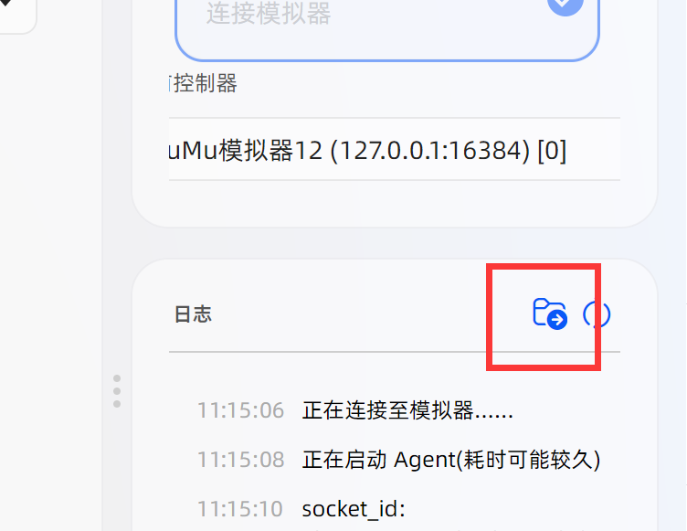

# 问题反馈

## 反馈渠道

如果你有 github 账号，请直接在[issue](https://github.com/duorua/narutomobile/issues?q=sort%3Aupdated-desc+is%3Aissue+is%3Aopen)中提交问题。

如果你没有 github 账号，请加入 QQ 群：[1047724031](https://qm.qq.com/q/Mck36YvBsu) 并向管理员提供必要的信息（见下文）。

## 一般问题

遇到问题时请先查询[常见问题](./faq.md)中是否有可用的解决方案。



如果你的问题不在常见问题当中，请导出日志并将日志文件发送给 QQ 群管理员，并提供出现问题时的MAN截图和火影当前界面截图，最好描述一下复现这个问题的方法，比如“在执行时候在什么情况下会在某个页面卡住”。当然，也可以开一个[issue](https://github.com/duorua/narutomobile/issues?q=sort%3Aupdated-desc+is%3Aissue+is%3Aopen)。

> [!TIP]
>
> 导出的日志文件包含windows用户的路径（类似`C:/Users/用户名/AppData/Local/...`），如果你的用户名使用了真名，请考虑自行进行打码操作。

## 软件闪退

如果 MAN 真的闪退，需向管理员提供`dump`文件。按`Win+R`打开运行窗口，输入：

```text
%LOCALAPPDATA%\CrashDumps
```

这个目录通常就是 Windows 保存用户程序崩溃转储的默认位置。按修改时间排序，找到闪退时间附近的名字带有`MFAAvalonia`的`<程序名>.exe.<数字>.dmp`文件。

注意：不是每次闪退都会自动生成`.dmp`文件。如果该目录没有对应文件，请直接说明情况，并继续提供打包的日志压缩包。

---

> [!WARNING]
> 不要用`卡了`，`不动了`等模糊语言来描述问题，这不能解决任何问题。

---

> [!NOTE]
> 火影手游自身导致的异常，比如游戏闪退，画面异常等*真投入*问题与MAN无关，只能自行解决。
